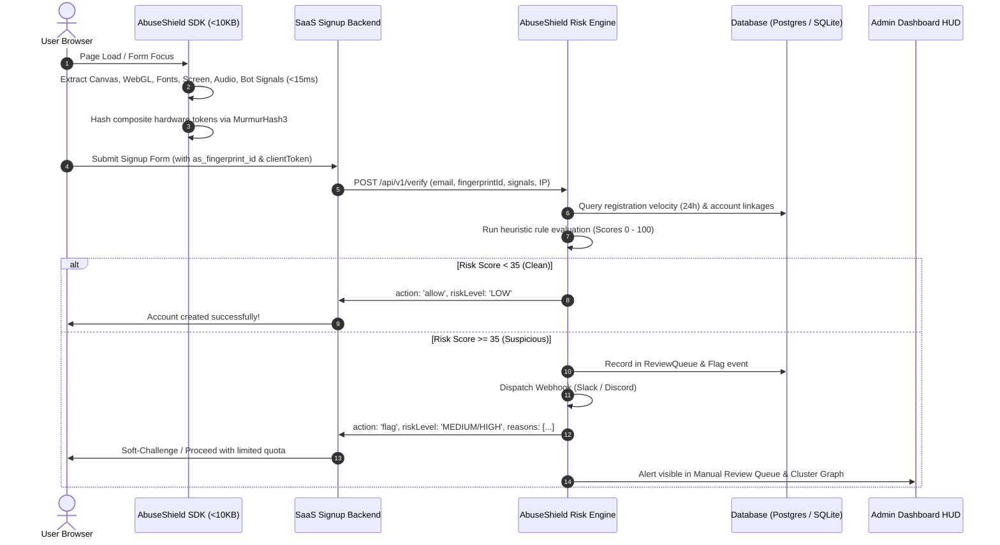
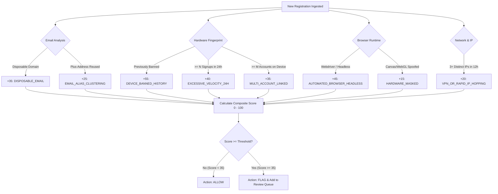

# TCT Shield: Comprehensive System Architecture, Mechanics & Developer Guide

> **Lightweight Fingerprint SDK & Free-Tier Abuse Prevention Platform for Modern Freemium SaaS**

---

## 📑 Table of Contents
1. [Executive Summary & Problem Statement](#1-executive-summary--problem-statement)
2. [Why TCT Shield Is Invaluable (Business Value & ROI)](#2-why-tct-shield-is-invaluable-business-value--roi)
3. [System Architecture & Monorepo Structure](#3-system-architecture--monorepo-structure)
4. [How the Client-Side SDK Works (<10KB Engine)](#4-how-the-client-side-sdk-works-10kb-engine)
5. [How the Backend Risk Scoring Engine Works](#5-how-the-backend-risk-scoring-engine-works)
6. [Dual-Engine Database & ORM Optimizations](#6-dual-engine-database--orm-optimizations)
7. [Admin Dashboard & Operator Capabilities](#7-admin-dashboard--operator-capabilities)
8. [Integration & Usage Guide](#8-integration--usage-guide)
9. [Complete API Reference](#9-complete-api-reference)
10. [Testing, Benchmarking & Deployment](#10-testing-benchmarking--deployment)

---

## 1. Executive Summary & Problem Statement

### The Problem
Freemium and free-trial business models drive customer acquisition for modern SaaS companies, AI products, developer APIs, and cloud services. However, offering free credits or computational resources creates a high-incentive target for bad actors:

1. **Multi-Accounting & Free-Tier Quota Harvesters**: Single users repeatedly register new accounts to exploit free LLM tokens, cloud compute, or trial tiers without ever paying.
2. **VPN & Rotating Proxy Bypass**: Attackers easily bypass simple IP rate-limiting by utilizing consumer VPNs or commercial proxy pools.
3. **Disposable & Subaddressed Email Spam**: Abusers automate registrations using disposable email providers (`mailinator.com`, `temp-mail.org`, `10minutemail.com`) or mailbox subaddressing (`user+trial1@gmail.com`, `user.name@gmail.com`).
4. **Scripted Bot Attacks**: Headless browsers (Puppeteer, Playwright, Selenium) programmatically generate accounts at scale.

### The Traditional Dilemma
- **Enterprise Solutions ([Castle.io](https://castle.io), FingerprintJS Pro, Sift)**: Cost **$200 to $500+/month**, feature heavy enterprise lock-in, and bloat the client bundle by 40–100+ KB.
- **Naïve Homegrown Solutions**: Restricting by IP address damages shared office or university networks, while hard-blocking on subtle risk flags causes devastating false positives that turn away paying customers.

### The TCT Shield Solution
**TCT Shield** is an open-architecture, developer-first anti-abuse system engineered specifically for indie hackers, startups, and growing SaaS platforms. It combines an **ultra-lightweight client SDK (<10KB raw, 5.2KB gzipped)** with an **explainable risk-scoring backend**, **cluster visualization**, and a **human-in-the-loop manual review queue**.

---

## 2. Why TCT Shield Is Invaluable (Business Value & ROI)

| Evaluation Factor | Naïve IP Throttling | Enterprise Anti-Fraud ($500/mo) | **TCT Shield** |
| :--- | :--- | :--- | :--- |
| **SDK Bundle Footprint** | None | 40KB – 120KB+ | **<10KB raw (5.2KB gzipped)** |
| **Execution Latency** | 0ms | 80ms – 250ms | **~15ms** |
| **Monthly Cost** | Free (but loses money in compute) | $200 – $500+/month | **$29 – $79/mo** (or Self-Hosted Open-Source) |
| **VPN / Proxy Resistance** | ❌ Fails completely | ✅ High | ✅ **High (Hardware-bound Fingerprint)** |
| **Customer Friction** | High false-positive lockouts | Black-box friction & CAPTCHAs | **Zero silent blocking** (Soft review queue) |
| **Data Privacy & Ownership** | Total | Third-party vendor storage | **100% self-hosted on your DB** |

### Tangible ROI Calculation
If an AI startup spends **$0.03 in GPU/LLM compute** per free trial registration:
- An abuser running a bot farm creating **500 fake accounts/month** costs the startup **$150/month in direct infrastructure loss**, plus database bloat and polluted analytics.
- At 2,000 fraudulent signups/month, the loss escalates to **$600/month**.
- AbuseShield intercepts this multi-accounting on day one, recovering multiple times its operating cost immediately.

---

## 3. System Architecture & Monorepo Structure

AbuseShield is structured as a TypeScript workspace monorepo:

```
Free-Tier Abuse Detection & Lightweight Fingerprint SDK/
├── packages/
│   ├── sdk/                     # Ultra-lightweight Browser Fingerprint JS SDK (< 10 KB)
│   │   ├── src/
│   │   │   ├── signals/         # Canvas, WebGL, Screen, Fonts, Audio, System, Bot, Storage
│   │   │   ├── hash.ts          # Deterministic MurmurHash3 & 64-bit hex hashing
│   │   │   ├── browser.ts       # Standalone IIFE bundle entry point
│   │   │   ├── types.ts         # TypeScript signal & response contracts
│   │   │   └── index.ts         # Client singleton: init(), getFingerprint(), verify(), attachForm()
│   │   └── dist/                # abuse-shield.min.js (5.2KB gz), index.esm.js, index.cjs
│   │
│   ├── server/                  # High-Performance Backend & Risk Engine
│   │   ├── prisma/              # Prisma schema & PostgreSQL migration definitions
│   │   ├── src/
│   │   │   ├── db/              # Dual DB driver: PostgreSQL (Prisma) + SQLite fallback
│   │   │   ├── services/        # RiskEngine, EmailValidator, IPEnricher, ClusterService, Webhook
│   │   │   ├── routes/          # REST endpoints (/verify, /review-queue, /rules, /analytics, /simulate)
│   │   │   └── index.ts         # Express app server, static asset host & route mounter
│   │   └── dist/
│   │
│   └── dashboard/               # Indie Admin HUD & Analytics Dashboard
│       └── src/                 # React 18 + Vite + Tailwind CSS + Lucide Icons
│           ├── pages/           # Overview, ReviewQueue, Fingerprints, ClusterGraph, RulesConfig
│           └── api.ts           # REST API client
│
└── demo-saas/                   # "VoxelAI Studio" Interactive Sandbox Application
    └── index.html               # Real-world SaaS signup form with live signal inspector
```

### End-to-End Data Flow



---

## 4. How the Client-Side SDK Works (<10KB Engine)

The SDK (`@abuseshield/sdk`) collects browser and hardware characteristics **without requiring invasive permissions, cameras, geolocation, or storage prompts**. It runs in under **15 milliseconds** and compresses to **5.2 KB gzipped**.

### 1. Canvas Rasterization (`packages/sdk/src/signals/canvas.ts`)
- **Mechanism**: Creates an off-screen HTML5 `<canvas>` element (240x60 px) and renders multi-layered graphics:
  - Winding rule test (`isPointInPath` with even-odd winding).
  - Multi-stop color linear gradients.
  - Complex geometric paths with subpixel anti-aliasing.
  - Mixed unicode fonts and emojis (`AbuseShield🛡️ 123.45` and `Anti-Fraud SDK 🔍`).
  - Drop shadow offset and blur calculations.
- **Why it works**: Operating system typography engines (DirectWrite on Windows, CoreText on macOS, FreeType on Linux) and GPU drivers rasterize subpixel fonts and floating-point curves uniquely.
- **Output**: Deterministic 64-bit MurmurHash3 digest.

### 2. WebGL GPU Architecture (`packages/sdk/src/signals/webgl.ts`)
- **Mechanism**: Initializes an off-screen WebGL context and inspects `WEBGL_debug_renderer_info`.
- **Extracted Attributes**:
  - `UNMASKED_VENDOR_WEBGL` (e.g. `Google Inc. (NVIDIA)`, `Apple`, `Intel Inc.`).
  - `UNMASKED_RENDERER_WEBGL` (e.g. `NVIDIA GeForce RTX 3080`, `Apple M2 Pro`).
  - High-float shader precision formats (`rangeMin`, `rangeMax`, `precision` for vertex and fragment shaders).
  - Array of supported hardware WebGL extensions.
- **Why it works**: Hardware-level GPU signatures cannot be bypassed simply by changing IP addresses or using incognito mode.

### 3. DOM Glyph Font Detection (`packages/sdk/src/signals/fonts.ts`)
- **Mechanism**: Measures typographic character bounding boxes (`offsetWidth`, `offsetHeight`) of a discriminatory test string (`mmmmmmmmmmlliWWWW12345`) at 72px against 3 fallback font families (`monospace`, `sans-serif`, `serif`).
- **Target OS Fonts**: Analyzes 18 distinctive system fonts across Windows, macOS, and Linux (e.g., `SF Pro Text`, `Calibri`, `Consolas`, `Segoe UI`, `Menlo`, `Ubuntu`, `DejaVu Sans`, `PingFang SC`).
- **Performance**: Completes in **<4ms** without downloading external font files or causing network overhead.

### 4. Audio Dynamics Fingerprint (`packages/sdk/src/signals/audio.ts`)
- **Mechanism**: Uses `OfflineAudioContext` (44.1 kHz) to render a triangle oscillator (10 kHz) passed through a dynamic compression filter (`dynamicsCompressor` with attack, knee, ratio, and threshold settings).
- **Entropy**: Computes the sum of output float samples. Slight discrepancies in floating-point audio processing across audio DSP chips and OS audio stacks produce unique values.
- **Resilience**: Enclosed in a 350ms non-blocking fallback timeout to prevent hanging in headless runtimes.

### 5. Bot & Automation Framework Detection (`packages/sdk/src/signals/bot.ts`)
- Evaluates real-time automation markers:
  - `navigator.webdriver` (standard automated testing flag).
  - Selenium / Webdriver hooks: `_Selenium_IDE_Recorder`, `__webdriver_evaluate`, `__selenium_evaluate`, `__webdriver_script_function`.
  - PhantomJS markers: `callPhantom`, `_phantom`.
  - Puppeteer / Playwright hooks: `__nightmare`, `__puppeteer_evaluation_script__`, `chrome` object missing runtime properties.
  - Headless user-agent patterns: `HeadlessChrome`, `PhantomJS`, or zero browser plugins combined with automation flags.

### 6. Screen & System Environment (`packages/sdk/src/signals/screen.ts`, `system.ts`)
- Screen resolution (`width`, `height`, `availWidth`, `availHeight`).
- Color depth, pixel depth, and `window.devicePixelRatio`.
- Maximum touch points (`navigator.maxTouchPoints`).
- Hardware concurrency (`navigator.hardwareConcurrency` CPU cores).
- System platform (`navigator.platform`), language, and user timezone (`Intl.DateTimeFormat`).

### 7. Persistent Multi-Layer Fallback (`packages/sdk/src/signals/storage.ts`)
- Generates and synchronizes a cryptographically random token (`_as_fp_token`) across both `localStorage` and a 1-year first-party cookie.
- Allows device continuity even if minor browser settings (such as screen zoom) fluctuate.

---

## 5. How the Backend Risk Scoring Engine Works

The core detection engine (`packages/server/src/services/riskEngine.ts`) evaluates incoming registrations against dynamic configurable rules. It aggregates points into a **Composite Risk Score (0 to 100)**:



### Risk Point Breakdown

| Rule Identifier | Weight | Condition Triggered |
| :--- | :---: | :--- |
| `DEVICE_BANNED_HISTORY` | **+55** | Fingerprint was previously tagged as `abuser` in review queue. |
| `AUTOMATED_BROWSER_HEADLESS` | **+45** | `navigator.webdriver` is true or HeadlessChrome detected. |
| `EXCESSIVE_VELOCITY_24H` | **+40** | Device exceeded max allowed registrations in 24h (default: 3). |
| `MULTI_ACCOUNT_LINKED` | **+35** | Device already linked to M distinct accounts (default: 2). |
| `DISPOSABLE_EMAIL` | **+35** | Email domain matches known disposable services (`mailinator.com`, etc.). |
| `EMAIL_ALIAS_CLUSTERING` | **+25** | Subaddressing alias (`user+1@...`) reusing an existing registered mailbox. |
| `VPN_OR_RAPID_IP_HOPPING` | **+20** | Same device observed across 3+ distinct IP subnets within 12 hours. |
| `HARDWARE_MASKED` | **+15** | Canvas or WebGL context blocked or artificially spoofed. |

### Decision Outcomes
- **`LOW` (Score 0 – 30)**: Action is `allow`. Legitimate user registration.
- **`MEDIUM` (Score 31 – 70)**: Action is `flag`. Added to staff **Manual Review Queue**.
- **`HIGH` / `CRITICAL` (Score 71 – 100)**: Action is `flag`. High-priority alert in **Manual Review Queue**.

> [!IMPORTANT]
> **No Black-Box Blocking Policy**: AbuseShield never silently terminates signups. When suspicious traffic is flagged, your SaaS can choose to soft-challenge (e.g., require credit card verification or email activation) or allow signup while restricting high-cost GPU/AI compute until reviewed.

---

## 6. Dual-Engine Database & ORM Optimizations

AbuseShield comes with dual database support to eliminate friction across local development, CI testing, and high-concurrency production deployments:

| Feature | Embedded SQLite Profile | Production PostgreSQL Profile |
| :--- | :--- | :--- |
| **Driver / Engine** | Node.js native `node:sqlite` (WAL Mode) | PostgreSQL 16 + Prisma ORM 6 |
| **Setup Overhead** | **Zero dependencies, zero Docker** | Docker Compose / Managed Postgres |
| **Use Cases** | Local development, rapid testing, unit tests | Production, high-volume multi-tenant SaaS |
| **Data Storage** | `packages/data/abuseshield.sqlite` | Relational tables with composite indexes |
| **Auto-Fallback** | Used automatically if Postgres connection fails | Activated via `DATABASE_URL` in `.env` |

### Key Database Performance Optimizations
1. **Zero N+1 Cluster Generation**: Sequential round-trip queries in `clusterService.ts` were replaced with batched `prisma.account.findMany({ where: { fingerprintId: { in: fpIds } } })`, shrinking 31 sequential database round-trips down to **just 2 queries**.
2. **Pipelined Metrics Transactions**: `analytics/overview` executes 5 concurrent aggregation queries via a single `prisma.$transaction([ ... ])` pipeline.
3. **Atomic Multi-Table Review Decisions**: Submitting an operator decision (`approve`, `reject`, `abuser`) executes in an atomic transaction across `reviewQueue`, `events`, `fingerprints`, and `accounts`.
4. **Resilient Connection Fallback**: If PostgreSQL is configured but the Docker container is stopped, AbuseShield catches `ECONNREFUSED` and seamlessly routes queries to local SQLite without crashing.

---

## 7. Admin Dashboard & Operator Capabilities

The Admin Dashboard is built with React 18, Vite, and Tailwind CSS. It is served directly from the server at `http://localhost:4000`:

### 1. Analytics & Executive HUD (`/`)
- Real-time KPI counters: **Total Signups**, **Flagged Events**, **Pending Reviews**, **Multi-Account Devices**.
- **Abuse Share Percentage**: Real-time gauge of what percentage of registrations are abusive.
- **Estimated Financial Savings**: Calculated directly from prevented free-tier quota drain.
- **24-Hour Activity Timeline**: Rolling hourly visualization of legitimate vs. flagged registrations.
- **Top Triggered Risk Rules**: Breakdown of the most active attack vectors (e.g., VPN rotation, temporary emails).

### 2. Manual Review Queue (`/queue`)
- Search and filter by status (`pending`, `approved`, `rejected`, `abuser`) or keywords.
- Deep-dive drawer showing:
  - Exact risk score and reasons breakdown.
  - Linked accounts discovered on the same hardware fingerprint.
  - Event history timeline for the device.
  - Raw hardware signals (GPU, Canvas, Screen, OS).
- One-click actions:
  - **Approve**: Whitelists the user account.
  - **Reject**: Rejects the flagged registration.
  - **Mark as Abuser**: Immediately bans the hardware fingerprint and all associated accounts across the entire application.

### 3. Multi-Account Cluster Visualizer (`/clusters`)
- Interactive relationship graph mapping the invisible connections between:
  - **Hardware Fingerprint Nodes** (Orange)
  - **User Account Mailboxes** (Cyan)
  - **Network IP Addresses** (Gray)
- Instantly surfaces coordinated abuse rings (e.g., 5 disposable accounts sharing 1 device across 3 VPN IPs).

### 4. Dynamic Rules & Settings (`/rules`)
- Sliders for 24-hour registration velocity limit.
- Sliders for maximum accounts allowed per hardware device.
- Toggles for Disposable Email, Headless Bot, and IP Hopping detection.
- Minimum risk score threshold to trigger flags.
- Outbound Webhook URL configuration for real-time Slack/Discord alerts.

### 5. Interactive Simulation Sandbox (`/playground`)
- Execute simulated attack profiles on demand:
  - **Clean Legitimate User**
  - **VPN Multi-Accounting Syndicate**
  - **Disposable Mailbox Farm**
  - **Automated Headless Bot**
  - **Seed Demo Dataset**

---

## 8. Integration & Usage Guide

### Method A: HTML Drop-In Script Tag (Landing Pages, Webflow, Carrd, Bubble)
Add the script tag to your `<head>` or before the closing `</body>` tag:

```html
<!-- Load AbuseShield SDK -->
<script
  src="https://your-abuseshield-domain.com/sdk/abuse-shield.min.js"
  data-api-key="pk_live_your_app_key"
  data-auto-attach="true">
</script>

<!-- Any signup or registration form -->
<form action="/api/signup" method="POST" data-abuseshield="true">
  <input type="text" name="name" placeholder="Full Name" required />
  <input type="email" name="email" placeholder="you@company.com" required />
  <input type="password" name="password" required />
  
  <!-- SDK automatically injects hidden inputs upon form submission:
       <input type="hidden" name="as_fingerprint_id" value="fp_..." />
       <input type="hidden" name="as_client_token" value="tok_..." />
  -->
  <button type="submit">Create Free Account</button>
</form>
```

### Method B: React / Next.js SPA Integration
Install or import the SDK in your front-end project:

```tsx
import React, { useState } from 'react';
import { AbuseShield } from '@abuseshield/sdk';

export function SignupForm() {
  const [email, setEmail] = useState('');
  const [loading, setLoading] = useState(false);

  const handleSubmit = async (e: React.FormEvent) => {
    e.preventDefault();
    setLoading(true);

    try {
      // 1. Evaluate fingerprint and verify action with AbuseShield
      const check = await AbuseShield.verify({
        email,
        action: 'signup',
      });

      console.log('AbuseShield Verification:', check);

      // 2. Submit to your SaaS registration backend with AbuseShield verification data
      const res = await fetch('/api/auth/register', {
        method: 'POST',
        headers: { 'Content-Type': 'application/json' },
        body: JSON.stringify({
          email,
          as_fingerprint_id: check.fingerprintId,
          as_risk_score: check.riskScore,
          as_action: check.action,
        }),
      });

      if (res.ok) {
        alert('Welcome! Your free account is ready.');
      }
    } catch (err) {
      console.error(err);
    } finally {
      setLoading(false);
    }
  };

  return (
    <form onSubmit={handleSubmit}>
      <input
        type="email"
        value={email}
        onChange={(e) => setEmail(e.target.value)}
        placeholder="you@domain.com"
        required
      />
      <button type="submit" disabled={loading}>
        {loading ? 'Verifying...' : 'Sign Up'}
      </button>
    </form>
  );
}
```

### Method C: Server-to-Server Backend Verification (Node.js / Express / Next.js API)

```typescript
import express from 'express';

const app = express();
app.use(express.json());

app.post('/api/auth/register', async (req, res) => {
  const { email, as_fingerprint_id, as_client_token } = req.body;

  // Verify registration risk with AbuseShield Server
  const verification = await fetch('http://localhost:4000/api/v1/verify', {
    method: 'POST',
    headers: {
      'Content-Type': 'application/json',
      'X-AbuseShield-Key': process.env.ABUSESHIELD_KEY || 'pk_live_demo',
    },
    body: JSON.stringify({
      email,
      clientFingerprintId: as_fingerprint_id,
      clientToken: as_client_token,
      action: 'signup',
    }),
  }).then((r) => r.json());

  if (verification.action === 'flag') {
    // High risk detected: flag user, alert team, or restrict free AI credits
    console.warn(`[Suspicious Signup] ${email} - Score: ${verification.riskScore}`, verification.reasons);
    
    // Example: Create account in 'restricted' mode requiring SMS or credit card confirmation
    return res.json({
      success: true,
      requiresVerification: true,
      message: 'Please verify your phone number to claim free compute credits.',
    });
  }

  // Clean signup: grant immediate full access
  return res.json({ success: true, requiresVerification: false });
});
```

---

## 9. Complete API Reference

Base URL: `http://localhost:4000/api/v1`

### 1. `POST /verify`
Evaluates browser signals and account history to return a risk score.
- **Headers**: `X-AbuseShield-Key: <api_key>`
- **Request Body**:
  ```json
  {
    "email": "user@example.com",
    "action": "signup",
    "clientFingerprintId": "fp_c8172b9a7f340812...",
    "clientToken": "tok_9918231...",
    "signals": { ... }
  }
  ```
- **Response**:
  ```json
  {
    "success": true,
    "action": "flag",
    "riskScore": 75,
    "riskLevel": "HIGH",
    "reasons": [
      "High registration velocity: 4 actions in 24 hours on this device",
      "Disposable / temporary email domain detected (mailinator.com)"
    ],
    "fingerprintId": "fp_c8172b9a7f340812...",
    "eventId": "ev_17291827361_abc",
    "reviewRequired": true
  }
  ```

### 2. `GET /review-queue`
Retrieves items flagged for operator review.
- **Query Parameters**:
  - `status`: `all` | `pending` | `approved` | `rejected` | `abuser` (default: `all`)
  - `search`: Filter by email, fingerprint ID, or IP address
  - `limit`: Number of records (default: 50, max: 100)
  - `offset`: Pagination offset

### 3. `POST /review-queue/:id/decision`
Submits an operator decision on a flagged item.
- **Request Body**:
  ```json
  {
    "decision": "approved" | "rejected" | "abuser",
    "notes": "Verified manual user request via email confirmation."
  }
  ```

### 4. `GET /analytics/overview`
Returns high-level anti-abuse metrics, 24-hour activity timeline, and top reason counts.

### 5. `GET /analytics/clusters`
Returns graph data (nodes, links, stats) for the relationship visualizer.

### 6. `GET /rules` & `PUT /rules`
Reads and updates threshold rules, scoring parameters, and webhook endpoints.

---

## 10. Testing, Benchmarking & Deployment

### Running the Test Suite
The test suite validates both client-side hashing algorithms and backend risk rules against active databases:

```bash
npm test
```

Test coverage includes:
- MurmurHash3 determinism and 64-bit hex integrity.
- Safe client-side execution in Node.js/SSR environments.
- Normalization of email aliases and disposable domain recognition.
- Legitimate first-time signup handling.
- Disposable email scoring.
- Multi-account correlation across shared hardware fingerprints.

### Starting in Local Mode (Zero Docker, SQLite)
```bash
# 1. Start server with embedded SQLite
npm start

# 2. In another terminal, seed demo attack scenarios
npm run db:seed
```

### Starting in Production Mode (PostgreSQL via WSL Docker)
```bash
# 1. Spin up PostgreSQL container
npm run docker:up

# 2. Synchronize Prisma schema
npm run prisma:generate
npm run prisma:push

# 3. Start server
npm start
```

### Default Port Mappings:
- **Admin Dashboard HUD**: `http://localhost:4000`
- **Interactive Sandbox Demo SaaS**: `http://localhost:4000/demo`
- **Client SDK Script Bundle**: `http://localhost:4000/sdk/abuse-shield.min.js`
- **REST API Base**: `http://localhost:4000/api/v1`

---

## 📄 License
MIT License. Engineered for indie developers and bootstrapped freemium SaaS teams.
